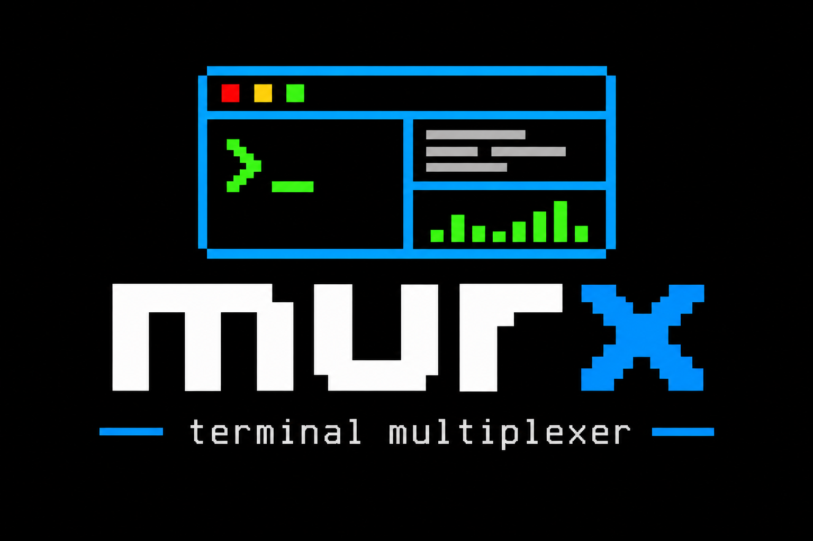

# murx



A deliberately small terminal multiplexer. One C file, no config file, no
dependencies.

```sh
make
./murx                          # session "0"
./murx work                     # separate named session
./murx 1                        # separate numbered session
./murx -p x work                # use Ctrl-X as this client's prefix
./murx --prefix x work          # same as -p x
./murx -s bottom work           # show the session status line at the bottom
./murx --status bottom work     # same as -s bottom
./murx --cwd work               # show the current directory in the status bar
./murx --murx work              # show [murx] on the left of the status bar
./murx -c 191a1c work           # use a grey status bar background
./murx --history 10000 work     # keep up to 10,000 history lines per pane
./murx --clock work             # show the status bar clock
./murx --hostname work          # show the hostname: prefix in window titles
./murx --pane-titles work       # show a title row above each pane
./murx -l, --list-sessions      # list running sessions without attaching
./murx --help                   # version, usage and all shortcuts
./murx -v, --version            # print the version and exit
```

Detach with `Ctrl-A d`. Run `murx` again to reattach.

Use `murx -l` or `murx --list-sessions` to list running sessions, sorted by
name, one per line. Listing works without a terminal and does not create or
attach to a session. It checks the current user's preferred socket directory
(`$XDG_RUNTIME_DIR/murx-<uid>/`, `$TMPDIR/murx-<uid>/`, or `/tmp/murx-<uid>/`)
and the `/tmp` fallback, skips stale sockets, and prints nothing when no
sessions are running. Do not pass a session name with this option. Use
`murx name` to attach to a listed session.

The [murx(1) manual](murx.1) covers all options, shortcuts, session behavior,
and remote shell setup. Read it locally with `man ./murx.1`. Run
`make install` to install both the program and manual, then use `man murx`.
The default prefix is `/usr/local`; override `PREFIX`, `BINDIR` or `MANDIR`
as needed. `DESTDIR` supports staged installs, and `make uninstall` removes
the installed program and manual.

Every shortcut is a chain that starts with the prefix (by default `Ctrl-A`):
press it, release it, then press the rest of the chain.

Use `-p x` or `--prefix x` to choose Ctrl-X instead; `--prefix` is the long
form of `-p`. Letters `a` through `z` select Ctrl-A through Ctrl-Z,
case-insensitively. The choice applies to this attached client; use the option
again when reattaching, or set a shell
alias such as `alias murx='murx -p x'`. Clients attached to the same session
can choose different prefixes.

With `-p x`, detach with `Ctrl-X d`, send a literal Ctrl-X with `Ctrl-X a`,
and switch to the last window with `Ctrl-X Ctrl-X`. Doubling the prefix takes
priority over any other control-key binding; `Ctrl-X x` still locks the client.
Ctrl-A is sent straight to the pane. All tables below show the default prefix;
replace it with your chosen key. When upgrading from a version without this
option, restart the session server once so it understands the prefix setting.

Use `-s top` or `-s bottom` (also `--status top|bottom`) to choose the status
line position. New sessions default to top. An explicit choice also updates an
existing session for all attached clients; omitting the option preserves its
position. Prompts and messages follow the status line. Restart servers from
older versions once before using this option.

Use `--cwd` to show the current directory on the left of the status bar,
and `--clock` to show the clock on the right. Use `--murx` to show `[murx]`
on the left when `--cwd` is not enabled; the directory takes precedence if
both are supplied. Use `--hostname` to show the `hostname:` prefix in window
names and the outer terminal title. These display options are disabled by
default. Use `--pane-titles` to show the title row above each pane. These
options set the initial values for a new session. The `Configuration...` menu
can change them in a running session (see [Menu](#menu)). To restore the
previous default display, use
`murx --cwd --clock --hostname session`.

## Upgrading from moerx

The executable, source and manual are now `murx`, `murx.c` and `murx.1`.
Update aliases and scripts to use `murx`. The status label is now disabled
by default; use `--murx` to enable it. Sessions use a separate `murx-<uid>` socket directory; finish
existing sessions with the old executable before removing it. Existing
sessions are not migrated automatically. Replace the optional remote SSH
hooks below and reload the remote shell: custom reports now use `murx-cwd`
and `murx-root`.

## What it does

- One persistent server per session (a Unix socket in
  `$XDG_RUNTIME_DIR/murx-<uid>/`, `$TMPDIR/murx-<uid>/`, or `/tmp/murx-<uid>/`,
  with a `/tmp` fallback for long paths).
- Windows, panes, splits, resizing, renaming and a status line.
- Real ptys per pane, a built-in VT100/xterm-ish screen emulator (colors,
  256-color and truecolor SGR, alternate screen, scrolling, UTF-8, wide
  characters).
- Application cursor-key mode follows the active pane, so arrow navigation
  works in programs such as Midnight Commander. Menus and prompts use normal
  cursor-key mode; detaching restores normal cursor keys in the outer terminal.
- Home (Pos1) and End use the pane’s `screen-256color` key sequences.
- Multiple clients can attach to the same session. The most recently attached
  or resized client sets the session size; a larger client shows the session
  centred in its terminal, while a smaller client shows the top-left part.
  `Ctrl-A R` forces the session back to the current client's terminal size.
- Panes run `$SHELL` as a login shell with `TERM=screen-256color` and
  `MURX=<session>`. They inherit the launching process's umask, so builds keep
  their usual file permissions. After upgrading from a version that forced `077`,
  restart the session server to apply the fix. In an existing shell, `umask 022`
  restores typical public file permissions for subsequent commands, including
  builds published with `rsync -a`. murx refuses to start inside another murx
  session; use `env -u MURX murx` to override intentionally.
- Window names show `program` for the foreground program in their active pane,
  refreshed every second, including in inactive windows. With `--hostname`,
  they show `hostname:program` (for example `laptop:zsh` or `laptop:vim`). When a program exits, the name returns to the shell. For
  pipelines, the foreground process group leader supplies the name. Linux uses
  `/proc`; other systems use `ps`.

## SSH window names and directories (optional)

Enable `--hostname` to display reported remote hostnames and `--cwd` to
display reported remote directories when creating the session. The hostname
examples below assume `--hostname` is enabled.

This section is **optional** and only needed if you want `murx` to show
details from inside an SSH session (remote hostname/program in window titles
and the window list, remote working directory in the status line, and reported
remote root status). If you do not use SSH from `murx`, or you are fine with
the pane being shown as the local `ssh` process (e.g. `local-hostname:ssh`),
you can skip this entire section—no remote configuration is required for
normal local use.

While an SSH pane is active, `murx` can show `[murx] remote-hostname:program`
(for example `[murx] server:vim`) in the outer terminal title and
`server:vim` in the window list, update it as remote programs start/stop, and
show the remote shell name (for example `server:zsh`) at a remote prompt.
Because SSH does not expose the remote foreground program, directory, or root
status to the local terminal, the **remote shell** must emit OSC title/reports
for `murx` to display this. Without those reports, names remain
`local-hostname:ssh` and remote directory/root details are not tracked.
Names refresh within one second; disconnecting restores the local hostname,
shell name, and path.

To enable remote root detection after `su` or `sudo -i`, install the matching
hook in **both the regular user's and root's shell startup files on the remote
host you connect to over SSH**. The hooks also activate in interactive
`screen-256color` terminals, so they continue working when privilege-switching
tools remove `$SSH_CONNECTION`. Root prompts and commands then turn the active
window name red; exiting back to the regular shell restores yellow. A reported
remote `su` command is red while it runs, even before the new shell reports its
UID. SSH disconnects restore local detection. No SSH server configuration
change is required.

### Zsh

If you want this optional integration, add this to `~/.zshrc` on the remote
host you connect to over SSH:

```zsh
if [[ -o interactive && ( -n $SSH_CONNECTION || $TERM == screen-256color ) ]]; then
    autoload -Uz add-zsh-hook
    murx_ssh_title() {
        local program=${1:t}
        printf '\033]2;%s:%s\007' "${HOST%%.*}" "$program"
        local directory=$PWD
        if [[ $directory == "$HOME" ]]; then
            directory='~'
        elif [[ $directory == "$HOME/"* ]]; then
            directory="~/${directory#"$HOME/"}"
        fi
        printf '\033]777;murx-cwd;%s\007' "$directory"
        printf '\033]777;murx-root;%s\007' "$((EUID == 0))"
    }
    murx_ssh_preexec() {
        local -a words
        words=(${(z)1})
        murx_ssh_title "${(Q)words[1]}"
    }
    murx_ssh_precmd() { murx_ssh_title zsh; }
    add-zsh-hook preexec murx_ssh_preexec
    add-zsh-hook precmd murx_ssh_precmd
fi
```

This reports the command launched by the shell (the first command for a
pipeline), then `hostname:zsh` at the prompt. murx retains the latest
`hostname:program` for that SSH job when programs send other terminal titles,
so these cannot reset the window name to `local-hostname:ssh`.
The hook also reports the remote working directory before each command and at
each prompt, so the status bar follows remote `cd` commands and shows `~` for
the remote home directory. Disconnecting restores the local path. Restart
existing murx servers and reload the remote shell configuration after upgrading.

### Bash

If you want this optional integration, add this to `~/.bashrc` on the remote
host you connect to over SSH:

```bash
if [[ $- == *i* && ( -n $SSH_CONNECTION || $TERM == screen-256color ) &&
      -z ${murx_ssh_installed-} ]]; then
    murx_ssh_title() {
        local program=$1 directory=$PWD
        program=${program##*/}
        printf '\033]2;%s:%s\007' "${HOSTNAME%%.*}" "$program"
        if [[ $directory == "$HOME" ]]; then
            directory='~'
        elif [[ $directory == "$HOME/"* ]]; then
            directory="~/${directory#"$HOME/"}"
        fi
        printf '\033]777;murx-cwd;%s\007' "$directory"
        printf '\033]777;murx-root;%s\007' "$((EUID == 0))"
    }
    murx_ssh_preexec() {
        if [[ ${murx_ssh_ready-0} == 1 && $1 != murx_ssh_precmd ]]; then
            murx_ssh_ready=0
            local program rest
            read -r program rest <<< "$1"
            # Strip quotes around a simple command name without evaluating it.
            program=${program#\"}; program=${program%\"}
            program=${program#\'}; program=${program%\'}
            murx_ssh_title "$program"
        fi
        return 0
    }
    murx_ssh_precmd() {
        local last_status=$?
        murx_ssh_title bash
        murx_ssh_ready=1
        return "$last_status"
    }
    # Keep existing prompt commands, and run our prompt hook last.
    if [[ $(declare -p PROMPT_COMMAND 2>/dev/null) == 'declare -a '* ]]; then
        PROMPT_COMMAND+=(murx_ssh_precmd)
    else
        PROMPT_COMMAND=("${PROMPT_COMMAND-}" murx_ssh_precmd)
    fi
    trap 'murx_ssh_preexec "$BASH_COMMAND"' DEBUG
    murx_ssh_installed=1
fi
```

This updates `hostname:program` before a command, restores `hostname:bash`
at the prompt, and reports the remote directory with `$HOME` shortened to
`~`. The hooks print only invisible terminal updates. Source `~/.bashrc` or
open a new SSH shell after installing them.

The Bash snippet preserves string and array forms of `PROMPT_COMMAND` and
avoids duplicate hooks when sourced again. It installs a `DEBUG` trap; if your
shell configuration already uses one (for example through bash-preexec),
integrate these functions with that framework instead of replacing its trap.
Command names come from the first whitespace-delimited word of Bash's first
simple command; aliases, compound commands, assignments and quoted executable
paths containing spaces may display differently from the Zsh hook. The command
text is never evaluated by the hook. Do not enable function tracing (`set -T`)
for these hooks.

murx accepts standard OSC 7 reports (`ESC ] 7 ; file://host/path BEL`) too,
including percent-encoded paths. These display the reported absolute path;
`OSC 777;murx-cwd;path` accepts either an absolute path or a path starting with
`~` and preserves that abbreviation. Reports belong to the foreground job
that sent them, so an old SSH connection cannot override the local shell's path.
The hooks also send `OSC 777;murx-root;1` for effective UID 0 and
`OSC 777;murx-root;0` otherwise, allowing the active remote window name to turn
red in a root shell. This is a visual hint based on shell reports, not a
security indicator.

Other shells can use equivalent
hooks sending `printf '\033]2;server:vim\007'`; use a hostname containing only
letters, digits, dots, underscores or hyphens, and a program basename without
spaces or colons. With splits, the window follows its active pane.

## Keys

The default prefix is `Ctrl-A`. Every shortcut below shows the default prefix;
if you chose a different prefix with `-p`, `--prefix`, or the Configuration
menu, press that prefix instead. Doubling the prefix switches to the last
window.

| Chain | Action |
| --- | --- |
| `Ctrl-A m` | open the main menu |
| `Ctrl-A a` | send the prefix literally to the pane |
| `Ctrl-A c`, `Ctrl-A Ctrl-C` | new window |
| `Ctrl-A n`, `Ctrl-A Space`, `Ctrl-A Ctrl-N`, `Ctrl-A Ctrl-@` | next window |
| `Ctrl-A p`, `Ctrl-A Ctrl-P`, `Ctrl-A Backspace` | previous window |
| `Ctrl-A Ctrl-A` | last window |
| `Ctrl-A w`, `Ctrl-A Ctrl-W`, `Ctrl-A "` | window menu (↑/↓, `j`/`k`, Enter) |
| `Ctrl-A A` | temporarily rename window (until the next automatic name refresh) |
| `Ctrl-A 0` … `Ctrl-A 9` | select window by its number in the status line |
| `Ctrl-A -` | split top/bottom |
| `Ctrl-A \|`, `Ctrl-A %` | split left/right |
| `Ctrl-A h` `Ctrl-A j` `Ctrl-A k` `Ctrl-A l`, `Ctrl-A` ↑/↓/←/→ | select pane |
| `Ctrl-A Tab` / `Ctrl-A Shift-Tab` | next / previous pane |
| `Ctrl-A o` | next pane |
| `Ctrl-A Ctrl-H` `Ctrl-A Ctrl-J` `Ctrl-A Ctrl-K` `Ctrl-A Ctrl-L` | resize pane (8/5/5/8) |
| `Ctrl-A x`, `Ctrl-A Ctrl-X` | lock the client |
| `Ctrl-A Page Up`, `Ctrl-A [` | enter scrollback (Page Up also scrolls one page) |
| `Ctrl-A K` | kill pane (confirm) |
| `Ctrl-A &` | kill window (confirm) |
| `Ctrl-A \` | kill server (confirm) |
| `Ctrl-A r` | show `Configuration Reloaded!` |
| `Ctrl-A R` | force the session to this client's terminal size |
| `Ctrl-A *` | list attached clients |
| `Ctrl-A d`, `Ctrl-A Ctrl-D` | detach |

Two bindings worth noting: `Ctrl-A Ctrl-H`/`Ctrl-A Ctrl-L` resize the pane
(they do not switch windows), and `Ctrl-A k` selects the pane above while
`Ctrl-A K` kills it.

## Menu

`Ctrl-A m` opens the main menu: a boxed overlay in murx blues, cyan and
yellow on black. Move with ↑/↓ (or `j`/`k`), press Enter to select, use
←/→ (or `h`/`l`) to enter or leave submenus, and press Escape, `q`, or
Ctrl-C to close. Long menus scroll when the terminal is short.

The main menu offers new window (tab), new pane (horizontal and vertical
splits), close pane/window, rename, the window list, pane selection and
resizing, and a `Session...` submenu with detach, lock, client list,
scrollback, forced resize and kill server. `Configuration...` contains:

- `Status line...` — position (top/bottom) and background (default, black
  `000000`, grey `191a1c`).
- `Prefix...` — this client's Ctrl-key prefix, `a` through `z`.
- Toggles for the current directory, clock, `[murx]` label, hostname and pane
  titles.
- `Reset display/status defaults`.

Press Enter on a toggle to turn it on or off. Settings changes apply
immediately. Session settings affect all attached
clients; the prefix is per-client. Nothing is written to disk, so changes
last until the session ends or you change them again. The command-line
options still decide the initial values when a session starts.

`Ctrl-A w` still opens the window list directly, now in the same menu style;
Left returns from it to the main menu. The menu items live in one table near
the top of `murx.c`, so adding entries does not mean changing the drawing or
key-handling code.

## Scrollback

Press `Ctrl-A`, then `Page Up` to scroll back in the active pane. Use
`Page Up` and `Page Down` without the prefix to move through history.
`Ctrl-A [` opens scrollback at the current screen. Press `q`, Escape,
Enter or Ctrl-C to return to live output. While browsing, use the usual
window shortcuts to switch directly, including `Ctrl-A n`, `Ctrl-A p`,
`Ctrl-A 0` through `Ctrl-A 9`, a double prefix, or `Ctrl-A w` for the window
chooser. Use `Ctrl-A c` to create a window while browsing. Returning to a 
window restores its scrollback view and position.

Each pane keeps up to 2,000 lines of normal screen history by default.
Use `murx --history 10000 work` when creating a session to keep up to 10,000
lines per pane. The limit accepts 0 to 100,000 lines, with 0 disabling history
retention. Reattaching to a session preserves its history limit.
The view is frozen while browsing; programs keep running and new output
continues to be saved when history retention is enabled.
Scrollback views are private to each client and saved per pane while attached.
Alternate-screen programs such as editors do not add history; opening
scrollback there shows only their current screen. History is kept in memory,
retains colors, and is clipped or padded to the pane width without reflow.
Restart an existing session server after upgrading to enable this feature.

## Colors

Hard-coded:

- Status on top by default (`-s bottom` moves it), default background (overridable with `-c`), 
  foreground `colour12`. The palette mirrors
  `~/.tmux.conf`.
- With `--cwd`, `[/path/to/directory]` on the left (directory in `colour14`, brackets
  `colour12`), refreshed every second and when switching panes. On Linux this
  follows the active pane's foreground process, falling back to its shell's
  directory; on other systems it shows the session's starting directory.
  Paths in `$HOME` use `~`, for example `[~/code/murx]`; `$HOME` itself
  appears as `[~]`. Long paths end in `...` to leave room for the window list and clock; the
  directory label is hidden when fewer than four columns remain. Remote SSH
  directories require a shell report; see [SSH window names and directories](#ssh-window-names-and-directories).
- With `--murx` and without `--cwd`, `[murx]` on the left.
- With `--clock`, `HH:MM:SS` on the right in `colour12`, refreshed every second.
- Window list right-aligned: current name `colour11`, or red `colour9` when
  its active pane's foreground process is `su` or has effective UID 0. Other
  window names use `colour12`; separators/flags use `colour14`. The color
  refreshes within one second and returns to yellow after leaving the root
  shell or switching to an unprivileged pane. Over SSH, the remote hooks above
  report root status; install them in each remote shell, including root's.
  A root shell that does not run the hooks cannot report its privilege change.
- Pane borders are thin box-drawing lines (`─`, `│`, `┬`, `┼`, ...) in
  `colour8`, drawn on the terminal's default background. Enable title rows
  with `--pane-titles` or the Configuration menu. Each title row shows
  `[N: title]`. On the active pane, brackets and numbers use `colour7`, the
  separator uses `colour11`, and the title uses `colour15`. Inactive panes
  use `colour8`, `colour3`, and `colour12`.
- Messages use `fg=colour6,bg=colour8`.
- Menus use a black background with a `colour12` frame, `colour11` titles and
  selection, `colour14` accents and dim `colour8` hints and separators.

Use `-c RRGGBB` or `--color RRGGBB` to set the session's status bar
background for all attached clients. Supply six hexadecimal digits, such as
`000000` for black. The session remembers the color across reattachments. New
sessions use the terminal's default background unless a color is supplied.

Colours are written to the outer terminal using 256-colour SGR (`38;5;n` /
`48;5;n`) by default. RGB pane colours are passed through as 24-bit SGR when
the outer terminal advertises `COLORTERM=truecolor` or `COLORTERM=24bit` and
`TERM` does not start with `screen`, `tmux`, `linux`, or `dumb`; otherwise RGB
is mapped to the nearest xterm-256 entry.

The terminal window title is set to `[murx] program`, following the active
murx window, or `[murx] hostname:program` with `--hostname`. Hostnames use
their short form (before the first dot). The `[murx]` prefix in the outer
terminal title is always present; `--murx` controls only the status bar label.

## Deliberate limitations

This is "very basic" by design:

- No config file, no command prompt, no scripting, no plugins.
- No text selection or copying in scrollback, no zoom, no activity monitoring,
  no clock mode.
- The lock screen is a cosmetic client lock: press Enter to unlock. It is not a
  password lock.
- Mouse reporting is not negotiated with the outer terminal.
- Killing the server affects only the current session, since each named
  session has its own small server process.
- At most 60 panes may be created in a window.
- Key repeat is not implemented: one resize step per key press.
- New windows start in the directory murx was started from, not in the
  current pane's directory.
- Resizing does not reflow existing text.
- Session dimensions are clamped to 1,000 columns and 1,000 rows. Numeric
  escape parameters saturate at the C integer limit; cursor movement and line
  operations are bounded by the screen and retained history. Invalid UTF-8
  is replaced with the replacement character. Allocation arithmetic that
  exceeds representable sizes terminates with a numeric-limit error.

## Build notes

Requires a C99 compiler and POSIX. Build with `make`. Runs on Linux, macOS,
FreeBSD and OpenBSD (using `openpty(3)` for panes; the Makefile links `-lutil`
automatically on the BSDs where it is needed). Tested with Clang and
GCC 16; `grid_resize()` carries a guarded workaround for a GCC 16 optimizer bug
that otherwise collapses pane grids to 1x1.

## Packages

The [Alpine recipe](alpine/APKBUILD) and [Arch recipe](arch/PKGBUILD)
build from the local checkout using symlinks to the source files. The package
version comes from `MURX_VERSION` in `murx.c`. Adjust the package release fields
separately as needed. Both recipes
build with the default C compiler and pass distro `CFLAGS` to `make`. The
packages install under `/usr`, including the manual, README, AUTHORS and
license.

On Alpine, install `alpine-sdk`, configure your abuild signing key with
`abuild-keygen -a -i`, and run as a regular user with abuild configured:

```sh
make pkgalpine
```

Install the resulting `murx` package and its `murx-doc` subpackage for the
manual. abuild writes packages beneath its configured repository destination
(normally `~/packages`); use `apk add /path/to/package.apk` for each signed
package after trusting your local signing key.

On Arch, install `base-devel` and run as a regular user:

```sh
make pkgsources
cd arch
makepkg -si
```

This builds the package and installs it through pacman. To build from the
repository root, run `make pkgarch`. The recipe lists
`x86_64` and `aarch64`; builds run on the current architecture.

For Gentoo, copy the [`app-misc/murx` package directory](gentoo/app-misc/murx)
into a configured local Portage overlay. The ebuild fetches the tagged release
archive and includes a Manifest with its checksums. It is keyworded `~amd64`;
accept that keyword for `app-misc/murx` if your system uses stable keywords.
Then install it with:

```sh
emerge --ask app-misc/murx
```

For a new Gentoo release, copy the ebuild to the new versioned filename and
run `ebuild murx-VERSION.ebuild manifest` after publishing the matching tag.

After changing a packaged source file, run `make pkgsums` to sync both package
versions and refresh both sets of checksums. This target requires `abuild`
and `updpkgsums` (from `pacman-contrib`). Neither recipe
requires a test suite; its check step runs `murx --help` as a smoke check.

### Debian

The [Debian packaging](debian/) builds from the local checkout. Install
`build-essential` and `debhelper`, then run:

```sh
dpkg-buildpackage -b -us -uc
```

The resulting `murx_*.deb` is written to the parent directory. Install it
with `apt install ../murx_1.0.3-1_$(dpkg --print-architecture).deb`.

### FreeBSD

Copy the [`sysutils/murx` port](freebsd/sysutils/murx/) into a FreeBSD Ports
tree. From the port directory, run `make package` to fetch the tagged source,
verify its checksum, and build a package. Install the resulting package with
`pkg add`. To update the port for a new release, change `DISTVERSION` and run
`make makesum` after publishing the matching tag.

### OpenBSD

Copy the [`sysutils/murx` port](openbsd/sysutils/murx/) into an OpenBSD ports
tree. From the port directory, run `make package` to fetch and verify the
tagged source and build a package. Run `make install` to install it through
the ports tree. For a new release, update `DISTNAME` and run `make makesum`
after publishing the matching tag.

## Authors

See [AUTHORS](AUTHORS) for project credits.

- Armin Jenewein - <a@bsd.pm> - Founder
- Johannes Findeisen - <you@hanez.org> - Contributor

## License

Copyright 2026 Armin Jenewein

The code of murx is licensed under the terms of the Apache-2.0 license. See
LICENSE for details.
